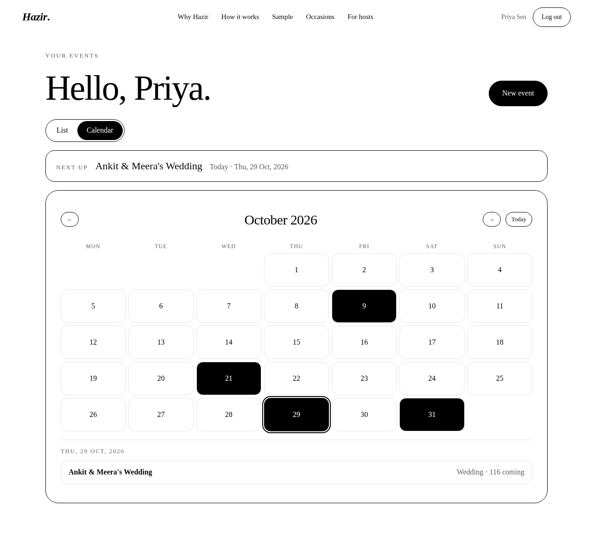

# Hazir (हाज़िर)



**Know who is coming.** Hazir turns invitations into answers. Guests say yes or no, say how many people are coming and when they will arrive. The host watches a live headcount, plate count and arrival curve. It works for weddings, birthdays, pujas, baby showers, dinners and corporate events.

Hazir means *present, here, accounted for*.

- Live demo: https://hazir-two.vercel.app/
- Stack: plain HTML, CSS and ES modules in the browser (no build step), Postgres with Row Level Security and email/password auth on a free hosted backend, static hosting on a free tier.

## Why it exists

Indian gatherings still run on WhatsApp. Hosts count replies by scrolling, guests say "will try", and the real number arrives at the gate: fewer or more people than expected, and many of them late. Food is wasted or runs out. Spreadsheets break at fifty rows and generic form tools do not know that a family of four is one answer with four plates and four meals.

Hazir asks the three questions a host needs answered: **are you coming, how many of you, and when will you arrive.**

## Features

Host (signed in with email and password):

- Sign up, log in, log out. Each host sees only their own events.
- Calendar view of all events: days with events are marked, details show on hover, keyboard focus or tap.
- RSVP closing date, exact time and timezone, enforced on the server. Close or reopen RSVPs manually, duplicate an event, add a venue and a message to guests, copy a caterer summary.
- Deleting an event needs typing the word delete in a styled confirmation, never a browser popup.
- Create, edit and delete events: name, occasion, date, host name, invited count, RSVP deadline, plus-one limit, usual arrival time.
- Optional guest name list: every named guest gets a personal link, so you see exactly who has not answered.
- Overview: coming, declined, awaiting, plates, days to go, answered progress, arrivals by hour, meal mix, group mix, latest answers. Refreshes itself every 15 seconds.
- Guests table: search, filter (coming, declined, awaiting, checked in), check-in toggle, remove, add names, add a walk-in or phone RSVP, CSV export (spreadsheet formula safe).
- Invites: open invite link, personal links, WhatsApp share and nudge buttons (they open WhatsApp with a prepared message, nothing is sent for you), copy all reminders.
- Day-of door list ordered by arrival time with a live arrived counter.

Guest (no account):

- One link, any phone. Yes or no, name, group, meal, party size up to the host's limit, each companion named with a meal, arrival time slider, note to the host.
- Personal links lock the answer to that guest and let them change it later. Answers close at the exact deadline time, enforced by the database, and guest answers have basic abuse limits (see docs/SECURITY.md).
- A guest can only see the event title, date, host name and deadline. Never other guests, meals or answers.

Landing page: the story, how it works, and a sample dashboard with made-up guests (stored only in your browser).

## Architecture

```
index.html            landing page
app.html              host app (login, events, dashboard)
rsvp.html             guest RSVP page
assets/css/           site.css (base + landing), app.css (host app + guest page)
src/lib/              config, http, session, auth, db, format, ui (no framework, no dependencies)
src/features/host/    host views: authView, eventsView, calendar, eventForm, dashboard/ (tabs, stats, csv, add guest, nudge)
src/pages/            entry points: host.js, rsvp.js, landing.js
supabase/schema.sql   tables, policies, functions, grants
tests/e2e.mjs         browser test of signup, RSVP and isolation against the real backend
docs/                 security model
```

Data flow: the browser talks straight to the backend's REST and Auth endpoints with a public publishable key. There is no custom server. Hosts use their own login token, so every query runs as that host and the database decides what they can see.

## Security model

- Row Level Security is on for `events`, `invitees` and `responses`. Policies allow a row only when `events.owner = auth.uid()`.
- The anonymous role has no table access at all. Guests call two `security definer` functions: `get_invite` (title, date, host, deadline, and the guest's own name for a personal link) and `submit_rsvp` (validates the event, deadline, token and party size, and caps responses).
- Personal tokens are random 96-bit values in each invitee row. A wrong token is rejected.
- The publishable key in `src/lib/config.js` is public by design. Never commit a service role key or a database password. `.gitignore` excludes env files.
- All user text is HTML-escaped before rendering. CSV export prefixes cells that start with `=`, `+`, `-` or `@`.
- Known limits: guest RSVPs have no CAPTCHA or per-IP rate limit on the free tier, and email verification and password reset are off (no mail provider is configured). Anyone can create a host account.

See `docs/SECURITY.md`.

## Run it yourself

1. Create a free project at https://supabase.com and run `supabase/schema.sql` in the SQL editor.
2. In Authentication, Sign In / Providers, turn off "Confirm email" (or configure your own SMTP provider and leave it on).
3. Put your project URL and publishable key in `src/lib/config.js`.
4. Serve the folder with any static host. Locally: `npx serve .` or `python3 -m http.server`.
5. Deploy: import the repo into any static host (it needs no build command). `vercel.json` adds basic security headers.

## Tests

```
npm i puppeteer-core
node tests/e2e.mjs            # serves the repo locally
BASE_URL=https://your-site node tests/e2e.mjs
BASE_URL=https://your-site node tests/features.mjs   # full feature walk-through, desktop and mobile
node tests/abuse.mjs                                  # guest answer limits
```

The test creates two throwaway host accounts and an event, answers it from a separate logged-out browser session, then checks that the other host and anonymous visitors cannot read or change it. It deletes its event afterwards. Throwaway accounts use the `hazir-e2e-` email prefix and can be removed from the Auth users list.

## Notes

- Free hosting tiers have limits and some are for non-commercial use only. Check your host's terms before running a paid service on it.
- Hazir sends no messages. WhatsApp buttons open WhatsApp with a prefilled text for you to send.

## Licence

Hazir is source-available under the **MIT License with the Commons Clause** (see [LICENSE](LICENSE)).

In plain words:

- You may read, run, copy, modify and share the code, including for your own events, your company or a non-profit.
- You may **not sell** it. Under the Commons Clause, "Sell" means offering a product or service to others for a fee or other consideration, including paid hosting, consulting or support, whose value comes entirely or substantially from Hazir.
- Keep the copyright notice and the license text with any copy.
- The software comes with no warranty.

This is not an OSI-approved open source license, so it is described as source-available. It is not legal advice; if you need certainty for a commercial situation, ask the author.
